

# Hoshi Reader Android

**English** | [简体中文](README.zh-CN.md)

Hoshi Reader Android is an EPUB reader for Japanese, English, Chinese, and Korean immersion, with Yomitan lookup, Anki card creation, audiobook read-along, text-to-speech, and e-ink display options.

This project brings [Hoshi Reader](https://github.com/Manhhao/Hoshi-Reader) to Android with native UI and Android-specific features.

<table>
  <tr>
    <td>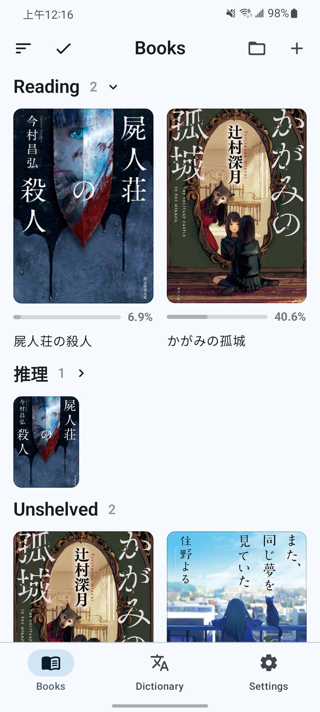</td>
    <td>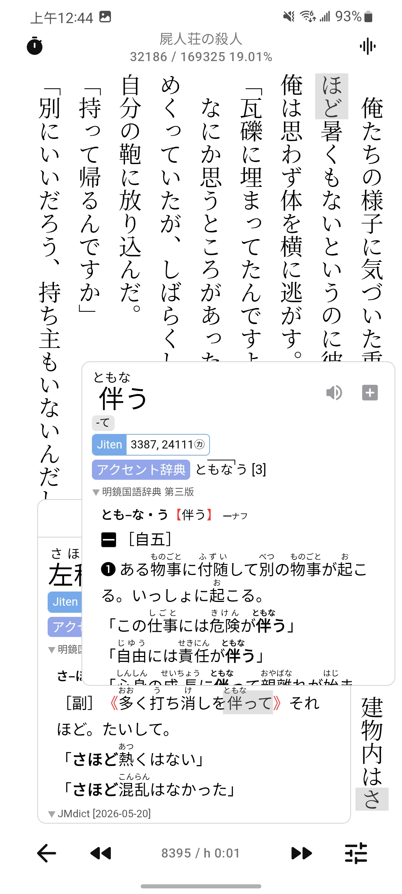</td>
    <td>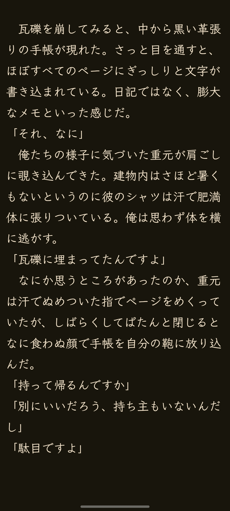</td>
    <td>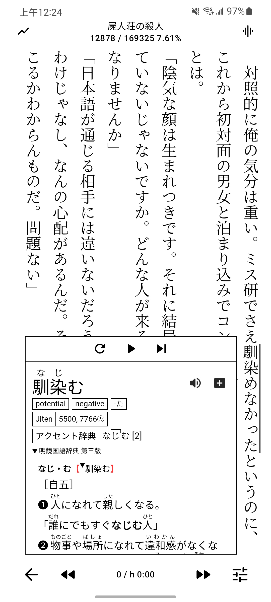</td>
  </tr>
  <tr>
    <td>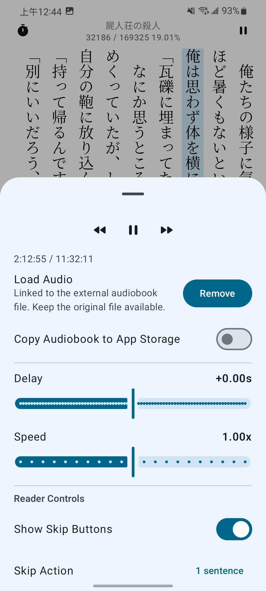</td>
    <td>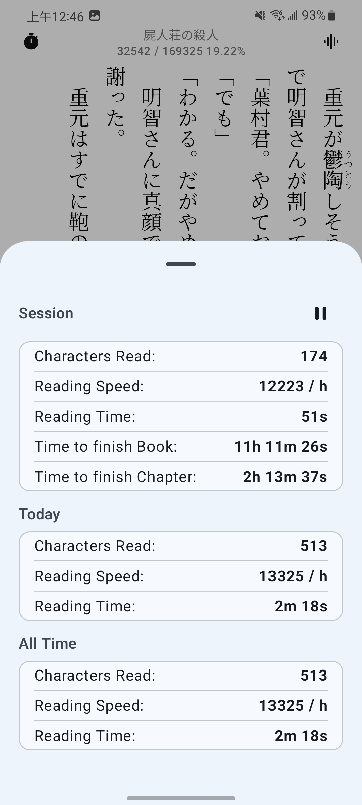</td>
    <td>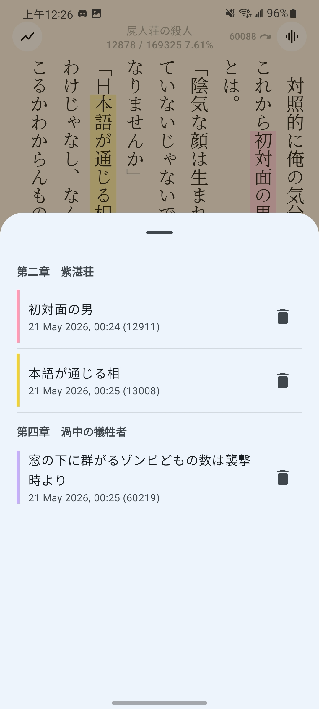</td>
    <td>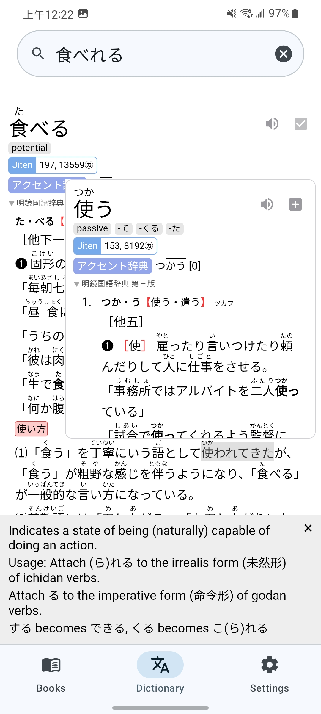</td>
  </tr>
  <tr>
    <td>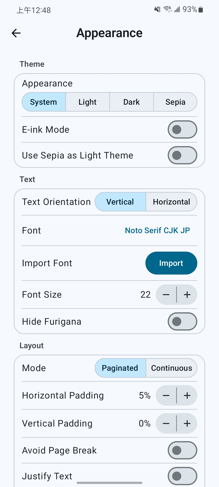</td>
    <td>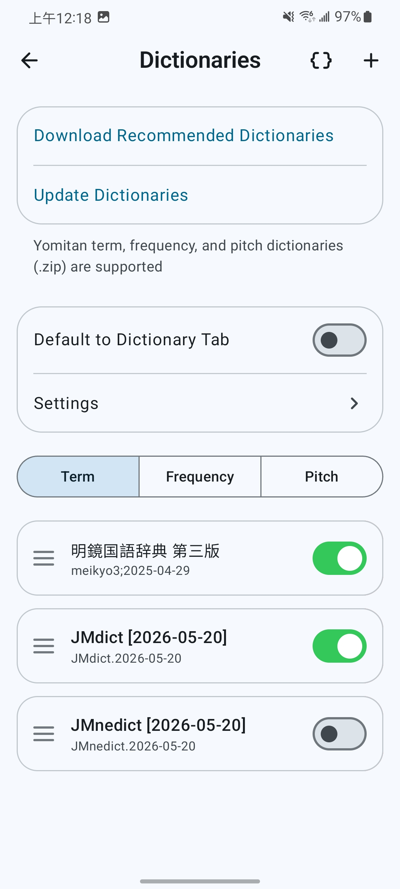</td>
    <td>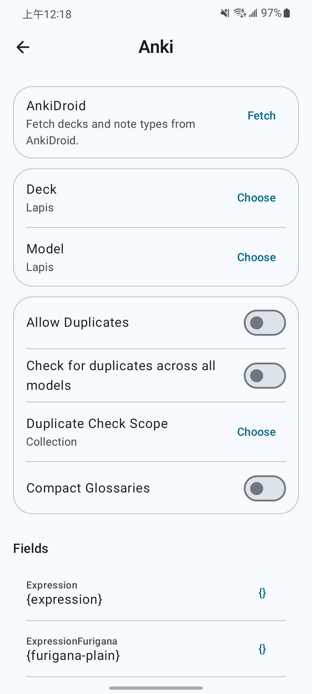</td>
    <td>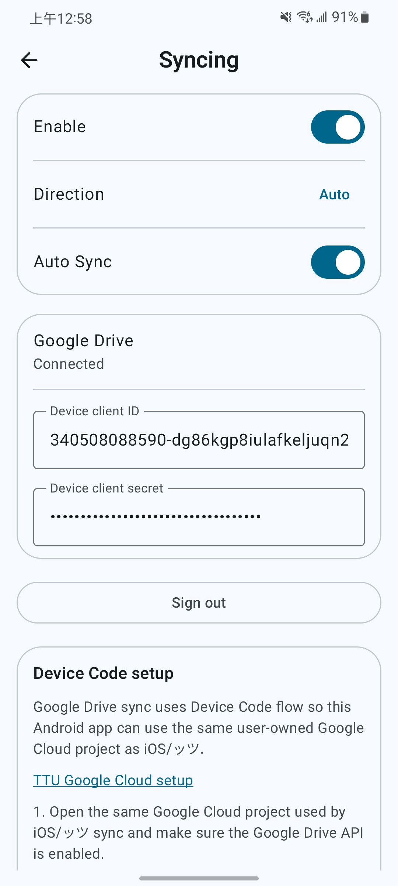</td>
  </tr>
</table>

## Features

### Bookshelf

- Import EPUBs in batches or recursively from folders, organize custom shelves, and export EPUBs.
- Show, blur, or hide book covers.
- Use book covers as lock-screen wallpapers or e-ink device screen savers.

### Reading

- Read vertically or horizontally in paginated or continuous mode; paragraph mode centers each page's content and adds sentence limits, optional text animation and tap-blank-to-advance.
- Download or import fonts and customize layout and furigana display.
- Search the full book, jump between chapters, and turn pages with volume keys.
- Browse illustrations fullscreen or in a gallery, with zoom, save, and share actions.

### Lookup

- Import or download Yomitan term, frequency, pitch-accent, and Kanji dictionaries, with categories and automatic updates.
- Look up words while reading, in standalone search, recursively inside definitions, or from other apps' text selections.
- Look up Japanese and Korean inflections, group Chinese entries with equivalent pinyin, and view Kanji stroke order.
- Sort results by frequency and customize popup styles and CSS.
- Use online or local word audio and choose recordings for playback and card creation.

### Profiles And Appearance

- Switch dictionary, reading, and Anki profiles automatically by language or assign them per book.
- Choose light, dark, or custom themes, with app-wide e-ink optimization.

### Highlights And Statistics

- Highlight passages in five colors, jump to highlights, and recolor or remove them.
- Track reading time, character/word counts, and speed with reading goals, calendar heatmaps, trend comparisons, and per-book totals.
- Edit reading records and retain statistics for deleted books.

### Anki Card Mining

- Create cards through AnkiDroid or AnkiConnect, with multiple card formats, duplicate checks, and access to existing notes.
- Use [Lapis](https://github.com/donkuri/lapis), Kiku, or Senren field presets and customize card content and tags.
- Include book covers, word audio, and audiobook or TTS sentence audio in your cards.

### Audiobook Read-Along (Sasayaki)

- Align audiobook subtitles with book text for sentence highlighting and automatic page turning, with adjustable speed, background playback and optional page-by-page playback in paragraph mode.
- Transcribe Japanese audiobooks on-device to generate subtitles.

### Text-To-Speech

- Use device, online, or self-hosted voices with background playback and adjustable speed. Voice language follows the active profile (Japanese, English, Chinese, or Korean), with narration/dialogue voices remembered per language and service.
- Replay dialogue marked with Japanese, curly, or straight double quotes within a paragraph; optionally split long sentences at clause punctuation for finer skipping and replay.
- Customize global or book-specific pronunciation dictionaries with regex replacements and furigana readings.

### Sync And Backup

- Sync books and reading data through Google Drive, compatible with Hoshi Reader iOS, Hoshi Reader Desktop, and ッツ Reader.
- Download cloud books on demand and remove local copies independently.
- Import and export ッツ bookdata and `.hoshi` backups.

## Download Hoshi Reader Android APK

Download the latest Hoshi Reader Android APK from [GitHub Releases](https://github.com/HuangAntimony/Hoshi-Reader-Android/releases/latest).

Hoshi Reader Android requires Android 8.0 or later.

## Development Status

Development adds reading features and refines the Android experience.
See [docs/CHANGELOG.md](docs/CHANGELOG.md) for released changes and work under Unreleased.

## Feature Requests

Submit ideas and describe your reading use case in this repository's [Issues](https://github.com/HuangAntimony/Hoshi-Reader-Android/issues).

## Support Development

If Hoshi helps your reading, you can support development through [GitHub Sponsors](https://github.com/sponsors/HuangAntimony) or [Ko-fi](https://ko-fi.com/huangantimony).

## Privacy And Data

Hoshi Reader Android stores imported books, dictionaries, fonts, audiobook data, reading progress, highlights, statistics, and settings locally in app storage.

Hoshi Google Drive sync uses Google Play Services sign-in, with browser OAuth when Play Services is unavailable. TTU sync uses a user-configured Google Cloud OAuth device-code flow. Both request access only to files used with the app. Anki card mining talks to AnkiDroid or the configured AnkiConnect endpoint. Online or self-hosted TTS sends narration text to the selected provider. Update checks read GitHub release metadata.

## Attribution

Hoshi Reader Android builds on this ecosystem:

- [Hoshi Reader iOS](https://github.com/Manhhao/Hoshi-Reader) as the reference implementation.
- [hoshidicts](https://github.com/Manhhao/hoshidicts) and [hoshidicts-kotlin-bridge](https://github.com/Manhhao/hoshidicts-kotlin-bridge) for Yomitan dictionary support.
- [rbook](https://github.com/DevinSterling/rbook) for EPUB parsing, connected through [UniFFI](https://github.com/mozilla/uniffi-rs).
- [FFmpeg](https://ffmpeg.org/) for native audiobook decoding and resampling.
- [Yomitan](https://github.com/yomidevs/yomitan) for dictionary format and lookup inspiration.
- [AnkiDroid](https://github.com/ankidroid/Anki-Android) for Android card creation integration.
- [Ankiconnect Android](https://github.com/KamWithK/AnkiconnectAndroid) for local audio behavior and AnkiDroid duplicate scope/checksum query references.
- [ッツ Ebook Reader](https://github.com/ttu-ttu/ebook-reader) for reader, statistics, and sync compatibility references.

## License

Distributed under the GNU General Public License v3.0. See [LICENSE](LICENSE) for details.

## Star History

If Hoshi Reader Android helps your reading workflow, please consider giving the project a star.

  <picture>
    <source media="(prefers-color-scheme: dark)" srcset="https://api.star-history.com/chart?repos=HuangAntimony/Hoshi-Reader-Android&type=date&theme=dark&legend=top-left" />
    <source media="(prefers-color-scheme: light)" srcset="https://api.star-history.com/chart?repos=HuangAntimony/Hoshi-Reader-Android&type=date&legend=top-left" />
    
  </picture>

